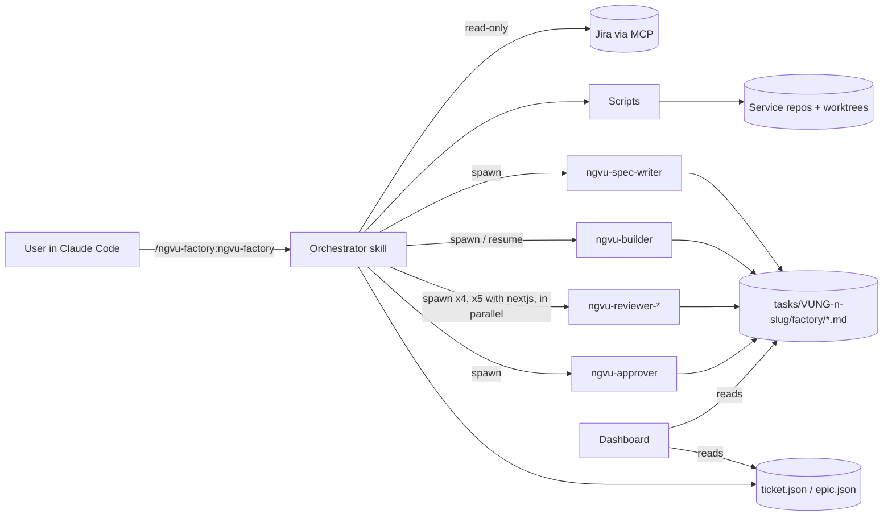

# Architecture

## Components

- **Deploy kit** (`deploy/ngvu-kit.ps1`, `deploy/bootstrap.sh`): the install. Run from any clone of
  this repo: `.\deploy\ngvu-kit.ps1 bootstrap -Team <team> [-Workspace <dir>] [-DryRun]` (Git Bash:
  `bash deploy/bootstrap.sh --team <team> [--workspace <dir>] [--dry-run]`). It adds this clone as
  the `ngvu-ai-factory` marketplace, installs the three plugins at user scope, copies the
  `core-governance` rules to `~/.claude/rules/`, writes the machine overlay
  `~/.claude/ngvu-factory/machine.json` (`workspace`, `factoryRepo`, `team`, `branchPrefix`,
  `ownTeams`, `paths`; kept if it exists), adds the Atlassian MCP write denies to
  `settings.json` and runs `doctor`. `--team` is required only on the first install of a machine.
  Details: `deploy/README.md`.
- **Plugins** (`plugins/`): `core-governance` (rules, governance skills, guard hooks),
  `ngvu-factory` (factory skill, investigation skills, agents, evals) and `ngvu-engineering`
  (ngvu engineering skills).
- **Guards** (`plugins/core-governance/hooks/`): plugin hooks declared in `hooks.json`, no
  `settings.json` entry needed. `guard.sh` (with `blocked-commands.tsv`, `protected-paths.tsv`) runs
  on Bash, PowerShell, Edit and Write; `ngvu_guardrails.py` on Bash and PowerShell blocks pushes
  other than a factory ticket/epic branch, destructive git and `acli` Jira writes. Both use
  `onFailure: block`, so a guard that cannot run blocks the call.
- **User-level install** (`install.sh`, `install.ps1`): the alternative to the deploy kit; copies the
  factory skills, agents and `ngvu_guardrails.py` into `~/.claude` and registers that hook in
  `settings.json`. Use one of the two, never both.
- **Investigation skills**: `ngvu-ticket-investigation` writes `<paths.tasks>/VUNG-<n>-<slug>/`
  (the input of `/ngvu-factory ticket`); `ngvu-epic-investigation` writes
  `<paths.tasks>/EPIC-VUNG-<e>-<slug>/` with the story breakdown, whose `## Factory queue` table
  `breakdown.sh` validates (R coverage, blockers, cycles) and prints as JSON for `/ngvu-factory epic`.
- **Orchestrator skill** (`plugins/ngvu-factory/skills/ngvu-factory/SKILL.md`): the session that
  runs `/ngvu-factory:ngvu-factory <command>` (user-level install: `/ngvu-factory <command>`)
  follows it, spawns agents and is the only writer of state files.
- **NGVU-CONTEXT.md**: verified stack facts every agent reads first.
- **Agents** (`plugins/ngvu-factory/agents/ngvu-*.md`): spec-writer, builder, four review lenses
  (five with nextjs repos: `frontend-ui`), approver. Each writes exactly one file.
- **Scripts** (`plugins/ngvu-factory/skills/ngvu-factory/scripts/`): small deterministic helpers for
  everything that must not be guessed. Each has a fixture test in `tests/`.
- **Clean-up** (`/ngvu-factory cleanup`, `scripts/cleanup-plan.sh`): read-only plan of worktrees,
  merged branches, `node_modules`, traces and session files of finished tickets; writes a script the
  human reads and runs.
- **Templates** (`plugins/ngvu-factory/skills/ngvu-factory/templates/`): the shape of every factory file.
- **Dashboard** (`dashboard/`): read-only board served on `127.0.0.1`.



## Files per ticket

```
<paths.tasks>/VUNG-<n>-<slug>/          investigation folder (ngvu-ticket-investigation)
  factory/
    ticket.json        state (orchestrator only)
    jira.md            Jira snapshot written at intake
    intake.md          what will be built where; approved by the user
    spec.md            ngvu-spec-writer
    build.md           ngvu-builder
    rework-<k>.md      your notes from /ngvu-factory rework
    round-<N>/review-{security-tenancy,code-conventions,contract-integration,data-persistence}.md
    round-<N>/review-frontend-ui.md   only when a repo has kind nextjs
    round-<N>/heads.txt  worktree HEADs at round start (review-guard.sh)
    decision.md        ngvu-approver (or the orchestrator when rounds are exhausted)
    it-results.md      the human's integration-test results (templates/it-results.md)
    PR-description.md  orchestrator, when ready-for-pr
    pr-feedback-<k>.md GitHub review comments from /ngvu-factory pr-feedback
    verify.md          /ngvu-factory verify
    retro.md           /ngvu-factory retro
    usage.jsonl        one line per finished agent run (cost-report.sh)
    cleanup-<UTC yyyymmdd-HHMM>.sh   plan written by /ngvu-factory cleanup; the human runs it

<paths.tasks>/EPIC-VUNG-<e>-<slug>/        epic investigation folder (ngvu-epic-investigation)
  factory/
    epic.json  queue.md  claims/<VUNG-key>/  EPIC-PR-description.md

<paths.tasks>/_cleanup-<UTC yyyymmdd-HHMM>.sh   /ngvu-factory cleanup without a key

<paths.worktrees>/VUNG-<n>/<repo>/          one worktree per touched repo
```

## State contract

Validated by `scripts/state-check.sh` after every write. The field list is in the orchestrator
skill's **State** section; the examples below follow it.

`ticket.json`:
```json
{
  "key": "VUNG-100001",
  "summary": "string",
  "epic": "VUNG-100002 or null",
  "folder": "VUNG-100001-example-ticket",
  "slug": "example-ticket",
  "repos": [ { "repo": "example_core", "kind": "java-service | nextjs", "owner": "<team>",
               "worktree": "<paths.worktrees>/VUNG-100001/example_core",
               "branch": "<team>/vung-100002/vung-100001-example-ticket",
               "base": "origin/<team>/vung-100002/EPIC-example-epic" } ],
  "stage": "intake | spec | build | review | approve | needs-human | ready-for-pr | verified | closed",
  "round": 0,
  "resumesLeft": 2,
  "reviews": { "securityTenancy": "pending", "codeConventions": "pending",
               "contractIntegration": "pending", "dataPersistence": "pending",
               "frontendUi": "pending | PASS | CHANGES, or n/a when no repo is nextjs" },
  "intakeApproved": false,
  "builderAgentId": "agent id returned when the builder was spawned, or null (optional)",
  "prLinks": { "example_core": "GitHub compare link, https://github.com/<owner>/<repo>/compare/<base>...<branch>?expand=1 (optional, written in Ready for PR)" },
  "openQuestionsAccepted": ["Q12", "EQ3"],
  "epicFolder": "EPIC-VUNG-100002-example-epic (optional, epic child)",
  "story": "S2 or null (optional, epic child)",
  "closedReason": "required when stage is closed",
  "updatedAt": "2026-10-15T10:00:00Z"
}
```

`epic.json` (written only by the epic intake session; child progress is derived from claims and
each child's own `ticket.json`, so parallel sessions never write the same file):
```json
{
  "key": "VUNG-100002", "summary": "string",
  "folder": "EPIC-VUNG-100002-example-epic", "slug": "example-epic",
  "repos": ["example_core"],
  "epicBranch": "<team>/vung-100002/EPIC-example-epic",
  "intakeApproved": true,
  "children": [ { "key": "VUNG-100001", "summary": "string",
                  "folder": "VUNG-100001-example-ticket or null",
                  "blockedBy": ["VUNG-..."], "externalBlockers": ["VUNG-..."],
                  "state": "queued | needs-investigation",
                  "story": "S2 or null (optional)" } ],
  "updatedAt": "2026-10-15T10:00:00Z"
}
```

## Exit codes

Shared by the factory scripts (`plugins/ngvu-factory/skills/ngvu-factory/scripts/`) and the deploy
kit. Investigation-skill scripts have their own: `breakdown.sh` uses 2 for an invalid Factory queue
and 3 for a missing file or section.

| Code | Meaning |
|---|---|
| 0 | ok |
| 1 | usage or internal error |
| 2 | malformed or missing file |
| 3 | no match / missing key |
| 4 | several matches |
| 5 | branch exists |
| 6 | ref conflict (`a/b` vs `a/b/c`) |
| 7 | git fetch failed |
| 8 | base ref missing |
| 9 | worktree path exists |
| 10 | already claimed |
| 11 | not merged |
| 12 | epic branch not on origin |
| 13 | non-ASCII found |
| 14 | not own team |
| 15 | no owner / no catalog |
| 16 | install or bootstrap needs confirmation (not a terminal, no `--yes`) |
| 17 | dependency cycle |
| 18 | no claim to release (`claim.sh --release`) |
| 19 | a worktree changed during review (`review-guard.sh verify`) |
| 20 | dependencies not installed (`unit-test.sh`) |
| 21 | bad time window (`error-count.sh`) |
| 22 | no log project for the environment (`error-count.sh`) |
| 23 | blocker merged to master after the epic branched (`blocker-merged.sh`) |
| 24 | nothing to clean (`cleanup-plan.sh`) |
| 30 | bootstrap prerequisite missing (git, python, Claude Code version, Git Bash) |

## Configuration

`plugins/ngvu-factory/skills/ngvu-factory/factory.config.json` is the team-wide default (changed
only by a PR to this repo). Each machine's `~/.claude/ngvu-factory/machine.json`, written by the
bootstrap, is merged over it; machine paths and the team live there.

| Key | Meaning |
|---|---|
| `workspace` | Workspace root of this machine (default `D:/workspace`; bootstrap `-Workspace`) |
| `factoryRepo` | This clone (where `retro` writes eval candidates) |
| `team` | Team name (bootstrap `-Team`, e.g. `ngvu`) |
| `branchPrefix` | Prefix of every branch the factory creates (`<team>/`) |
| `ownTeams` | Catalog owners that count as "ours"; other owners are listed for information only |
| `legacyOwnerAliases` | Old catalog owner names mapped to a team (e.g. `old-team` -> `ngvu`; empty by default) |
| `maxResumes` | Builder resumes after round 1 (2, so at most 3 review rounds) |
| `paths.repoRoots` | List of `{path, kind}` (`java-service`, `nextjs`) under the workspace |
| `paths.tasks` / `paths.worktrees` | Investigation folders and ticket worktrees |
| `unitTest.<kind>` | Unit-test gate command per repo kind (`unit-test.sh`; java-service default `mvn clean install -DskipITs=true -B`); supersedes `paths.unitTestScript`, which remains only as the `java-service` fallback |
| `reportLanguage` | Language of the prose in investigation reports (default `en`); headings stay English |
| `verify.defaultEnv` / `verify.logProject` / `verify.maxWindowHours` / `verify.cloudBuildProject` | `/ngvu-factory verify`: default environment, log project per environment, longest log window, Cloud Build project (null = ask the user) |
| `jira.site` / `jira.project` | Jira site and project key |
