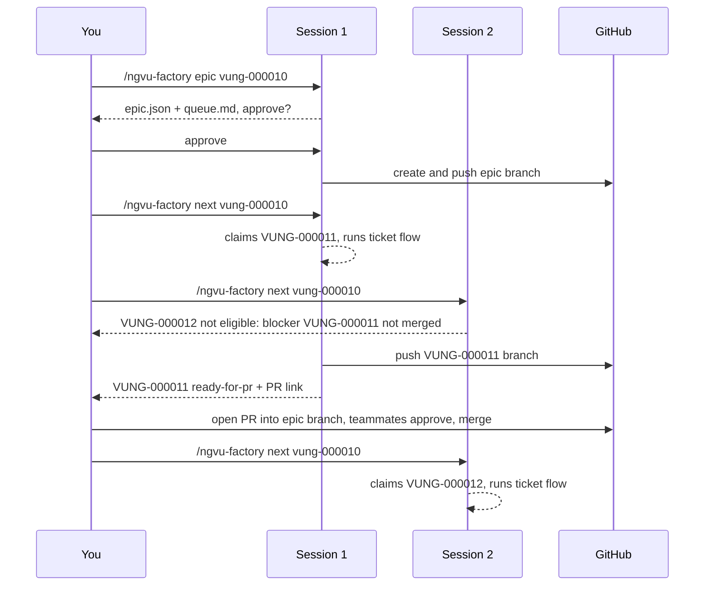

# Workflow: an epic

Commands: `/ngvu-factory epic vung-<e>` once, then `/ngvu-factory next vung-<e>` in as many sessions
as you want to run in parallel, then `/ngvu-factory finish-epic vung-<e>` (plugin install:
`/ngvu-factory:ngvu-factory <command>`).

Prerequisite: the epic is investigated with the `ngvu-epic-investigation` skill, which writes
`<paths.tasks>/EPIC-VUNG-<e>-<slug>/` including `08-STORY-BREAKDOWN.md` with its `## Factory queue`
table (story `S<n>`, Jira key, repos, owner, blocked by, covered requirements). Without the folder the
epic intake stops.

## Intake

1. Resolve the epic's investigation folder (you pick if there are several).
2. Read the epic and its children from Jira (read-only): JQL `parent = VUNG-<e> ORDER BY Rank ASC`.
   The issue must be an Epic. Children of type Test or Sub-task are never queued. A "Blocks" link
   with an `inwardIssue` means the child "is blocked by" that issue.
3. Read the Factory queue with `breakdown.sh <folder> --json`:
   - exit 2 (the table is invalid: uncovered requirement, unknown blocker, cycle, template text):
     the intake stops and shows the errors; the investigation fixes `08-STORY-BREAKDOWN.md`;
   - exit 3 (older folder without `## Factory queue`): `queue.md` says so and the children are the
     Jira children from step 2;
   - exit 0: the children are the stories that have a Jira key (each child records its `story`).
     A story key that is not a child of this epic stops the intake. A Jira child missing from the
     table (not Test/Sub-task, not Done) is listed under "Not in breakdown" and you decide whether to
     queue it. A story without a key is listed under "Not in Jira yet" and never queued (creating the
     issue is a Jira write, so a human does it). A story blocked by a story without a key
     (`blockedByUnkeyed`) stops the intake.
4. Blockers of a child are its Jira "Blocks" links plus its story's `blockedByKeys`. Blockers inside
   the epic go to `blockedBy`; others go to `externalBlockers` and must be Done in Jira before the
   child can start.
5. Every child needs its own investigation folder with a filled `04-IMPLEMENTATION-PLAN.md`. A child
   without a folder, or whose `04` still holds the template line `AC-1  WHEN ...`, is marked
   `needs-investigation` and is never claimed.
6. Repos: the union of the queued stories' repos and the repos named by each investigated child's
   `04-IMPLEMENTATION-PLAN.md`; unclear means the factory asks.
7. `queue-order.sh` orders children blockers-first (ties keep the order); a dependency cycle stops
   the intake.
8. `epic.json` and `queue.md` are written and **you approve**.

## Epic branches

After your approval, for every repo: if `<team>/vung-<e>/EPIC-<slug>` exists on origin nothing
happens; if the factory created it earlier but only locally, it is pushed; if it exists only
locally otherwise, or differs from origin, the factory stops and reports; else it is created from
`origin/master` with `create-branch.sh` and pushed. Children branch from it and their PRs
target it. The factory pushes the epic and child branches; a human only opens and merges the PRs.

## Parallel sessions

Each session runs `/ngvu-factory next vung-<e>`. It first refreshes children marked
`needs-investigation`: one whose folder now exists with a filled `04` becomes `queued`. New stories
or changed blockers in the Factory queue need a re-run of `/ngvu-factory epic vung-<e>` (it keeps the
epic branch and claims and asks for approval again).

Then it takes the first child in queue order that is queued, not Done in Jira (a Done child is listed
as "done in Jira" and never built), not claimed, has its external blockers Done, and has every
blocker merged (see below). A blocker whose ticket was `closed` in the factory: it shows the reason
and asks you whether it counts as done. It claims the child with an atomic `mkdir claims/<key>`, so
two sessions never take the same child, then runs the normal ticket workflow (including your intake
approval).

Cost: a clean ticket runs about seven agents, and up to three review rounds can bring it to 20. Start as
many sessions as you can afford, not as many as there are children.

## When a blocker counts as done

Only when its commits are in `origin/<epic branch>` after a fetch. `ready-for-pr` is not
enough: the next child must build on reviewed, merged code. `blocker-merged.sh` looks only at what
the epic branch adds on top of `origin/master`, and needs evidence of the blocker's own work there:

1. a commit titled `VUNG-<n>: ...` (the builder's commit convention); or
2. a merge commit `Merge pull request #N from <...>vung-<n>-<...>` (GitHub; Bitbucket's `Merged in <...> (pull request #N)` also works) - this also
   covers source branches deleted on merge. A GitHub squash merge leaves no merge commit: give the PR a title that starts `VUNG-<n>:`.

A branch that merely points at the epic tip (created, nothing built yet) is **not** merged. For a
blocker that ran through the factory every repo in its `ticket.json` must pass; for one that did
not, at least one epic repo must.

Exit 23 means the blocker was merged to master after the epic branched. It counts as merged for
`next`, but the epic branch lacks its code, so the child's intake stops and you choose: a human
brings `origin/master` into the epic branch through a reviewed PR and the intake is re-run, or the
child is built with `--independent` from `origin/master`.

## Finishing the epic

`/ngvu-factory finish-epic vung-<e>`:

1. Children still `needs-investigation` were never built: they are listed as "not built" and you
   decide whether the epic may finish without them.
2. Every other child must be merged into the epic branch in every repo it touched (same rule as
   `next`; exit 23 means it is already on master and needs no epic PR). Any not merged: listed, stop.
3. The plan must be met: `breakdown.sh` exits 0 (every requirement still covered; exit 3 on an older
   folder means the check was skipped, and it says so), and each item of the epic DoD in
   `11-ROADMAP-AND-DOD.md` §3.2 is listed as met or not met with its evidence. Any item not met: it
   shows the list and asks.
4. It writes `EPIC-PR-description.md` and gives you, per repo, the GitHub compare link to open the epic PR
   to `master`. You open the epic PRs; teammates review and approve; a human merges.
