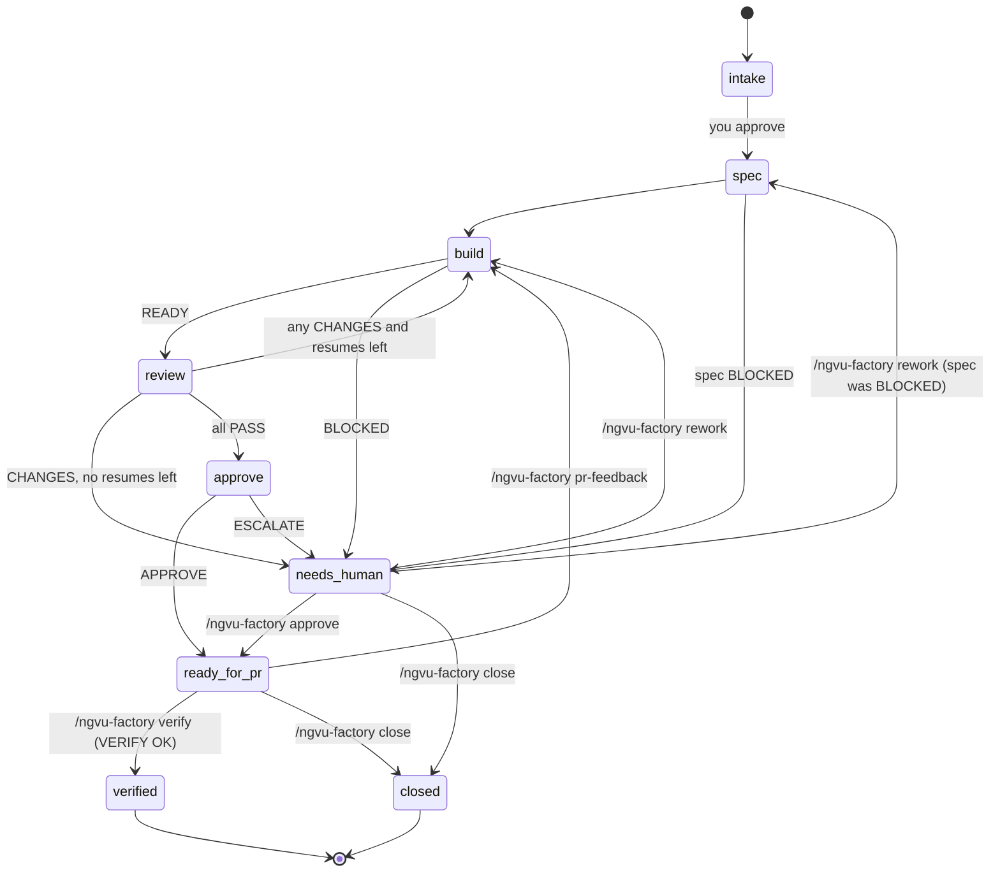
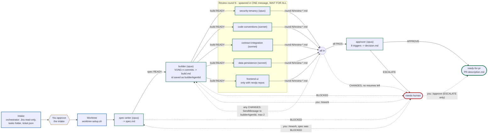

# Workflow: one ticket

Command: `/ngvu-factory:ngvu-factory ticket vung-<n>` (plugin install; the user-level install and the
rest of this page write it `/ngvu-factory ticket vung-<n>`). One ticket is one job, one branch per touched repo and one
PR. Jira sub-tasks are ignored (treated as process steps).

## Steps

1. **Intake** (read-only until you approve)
   1. Find the investigation folder with `resolve-task-folder.sh`. None: run
      `ngvu-ticket-investigation` first (`ngvu-epic-investigation` for an Epic). Several: you
      pick. No slug: you give one.
   2. Read Jira (read-only) and save `factory/jira.md`, including any "Acceptance" field.
   3. Take the touched repos from `04-IMPLEMENTATION-PLAN.md`. A missing `04`, or one that still
      holds the template line `AC-1  WHEN ...`, stops the intake: the investigation is not finished.
      Unclear repos: the factory asks. Each repo is resolved with `repo-path.sh` (exit 3: not
      cloned, stop; exit 4: several clones, stop until you remove the duplicate).
   4. Compute base and branch (see below), fetch, and check the branch name is free.
      For an epic child: the epic branch is `epicBranch` from the epic's `factory/epic.json`;
      `epicFolder` and `story` (the child's `S<n>` in the epic's Factory queue) are recorded in
      `ticket.json`. If a blocker went straight to master (`blocker-merged.sh` exit 23) the intake
      stops with two choices for you: a human brings `origin/master` into the epic branch through a
      reviewed PR and the intake is re-run, or the child is built with `--independent` from
      `origin/master`. A child started directly (not through `next`) has its blockers checked and is
      claimed (`claim.sh`; exit 10: another session has it, stop).
   5. Look up owners in `catalog-info.yaml` and list open questions from `08-OPEN-QUESTIONS.md`
      (for an epic child also the epic's `12-OPEN-QUESTIONS.md` rows for its story, as `EQ<n>`).
      An unanswered question that could change an acceptance criterion, authorization, a contract,
      a stored-data shape or failure behaviour (or is flagged 🔴) is **blocking**.
   6. Write `intake.md` and `ticket.json`, then **ask you to approve**. Nothing is built before that.
      With blocking questions a plain yes is not enough: answer them, or accept building on their
      defaults by naming them (e.g. "build on defaults Q12, EQ3"; recorded as
      `openQuestionsAccepted`, and the approver still escalates on them).
2. **Worktrees**: one per repo under `<paths.worktrees>/VUNG-<n>/<repo>/`.
3. **Spec**: `ngvu-spec-writer` copies the acceptance criteria verbatim (Jira first, else
   `04-IMPLEMENTATION-PLAN.md`, then the epic story for an epic child) or blocks.
4. **Build**: `ngvu-builder` implements, runs the unit-test gate of the repo kind, lists the ITs
   that reference changed classes for you to run, checks comments are English, commits `VUNG-<n>: ...`.
5. **Review**: `review-guard.sh snapshot` of every worktree; four lenses in parallel (five when a repo
   is `nextjs`); WAIT FOR ALL; `review-guard.sh verify` proves no reviewer changed code; any
   CHANGES resumes the builder (at most twice).
6. **Approve**: `ngvu-approver` returns APPROVE or ESCALATE.
7. **Ready for PR**: `PR-description.md`, then the orchestrator pushes each ticket branch
   (`git -C <worktree> push -u origin <branch>`) and hands you the GitHub pull request (compare)
   link. You open the PR; teammates approve; a person merges.

After the PR: `pr-feedback` (reviewer comments -> a new round, new commits pushed to the same PR),
`verify` (read-only check after the merge reached an environment), `retro` (misses -> eval
candidates). `close` ends a ticket whose work will not be used (from any stage except `closed`).
`cleanup` plans the removal of worktrees, merged branches and traces of a finished ticket; you run
the plan.

## How the agents trigger

The session that runs `/ngvu-factory` is the orchestrator. It runs the helper scripts, is the only
writer of `ticket.json`, and reads only line 1 of each agent file (`verdict.sh`). Every agent writes
exactly one file; if an agent finishes without it, the orchestrator asks that agent once to write
it, then stops. The animated version of this diagram is slide 6 ("How the agents trigger") of
`presentation/index.html`.

## Branch and base

| Ticket | Base | New branch |
|---|---|---|
| Child of epic `VUNG-<e>` | `origin/<epicBranch>` (from `epic.json`, e.g. `origin/<team>/vung-<e>/EPIC-<eslug>`); not on origin yet: the factory stops, run `/ngvu-factory epic vung-<e>` first (it pushes the epic branch) | `<team>/vung-<e>/vung-<n>-<slug>` |
| Standalone | `origin/master` | `<team>/vung-<n>-<slug>` |

- `<team>/` is the `branchPrefix` from your `machine.json` (e.g. `ngvu/`).
- The slug is the investigation folder's slug.
- Branches are always new. An existing branch for the same key is listed in the intake as
  "not reused"; move its code yourself if you need it.
- Git cannot hold both `a/b` and `a/b/c`: if a branch named exactly `<team>/vung-<e>` exists,
  the epic path cannot be created and the factory stops.
- Branches are created with `--no-track`; the factory sets the upstream only on its own push
  (`push -u` in **Ready for PR**).

## When it stops

The factory stops and tells you why when:

- the investigation folder is missing or ambiguous, or the slug is empty;
- Jira cannot be read;
- `04-IMPLEMENTATION-PLAN.md` is missing or still the template (not investigated), or the touched
  repos are not clear from it;
- a repo is not cloned, or has several clones (`repo-path.sh` exit 3/4);
- the epic branch is not on origin yet (run the epic intake first);
- a blocker of an epic child went straight to master (`blocker-merged.sh` exit 23): you choose how
  to base the child;
- the epic child is already claimed by another session (`claim.sh` exit 10);
- open questions are blocking and you neither answered them nor accepted their defaults by name;
- the branch already exists, has a ref conflict, `git fetch` fails, or the worktree path exists;
- you did not approve the intake;
- a factory file is missing or its first line is not a valid verdict;
- a reviewer moved a worktree HEAD or left changes during a review round (`review-guard.sh`, exit 19);
- spec or build is BLOCKED, review rounds are exhausted, or the approver escalates (`needs-human`).
